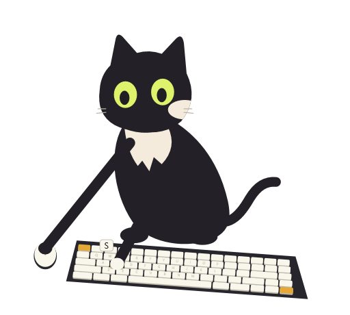
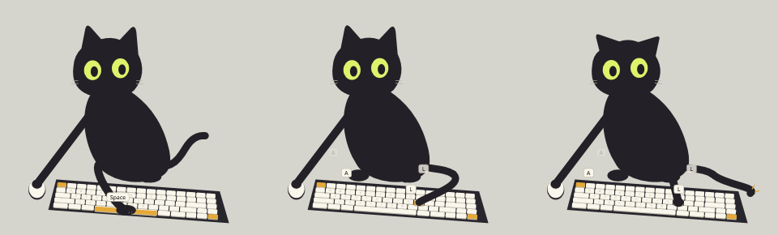

# Paws on Keys · 桌角猫

在 Windows 桌角养一只会跟你打字的猫。用照片取色，或从零捏猫，给它加上自家猫的脸斑和白爪。切回其他软件，猫仍会跟着你的鼠标推小鼠标、用爪子敲键，按下的键名会朝上飘。把光标放在它头顶，会看到猫眯起眼睛。



[下载 Windows EXE](https://github.com/silveryoung830/paws-on-keys/releases/latest/download/PawsOnKeys.exe)

## 会记录或上传我打的字吗？

**桌角猫不保存按键历史，也不上传按键或输入内容。** 键鼠联动开启时，即使你正在用别的软件，桌角猫也会在本机接收当前按下的物理键，用来决定猫爪落在哪里、屏幕上飘出哪颗键帽。手速统计只在内存中保留最近几秒的击键时刻，不包含键名。长按同一个键只算一次，停手 1.2 秒或暂停联动会清空手速统计。[输入处理](src/DesktopInput.cs) · [手速统计](src/TypingRhythm.cs) · [本机保存的设置](src/Settings.cs)

分享屏幕或输入密码时，可以右键托盘猫图标，选「暂停键鼠联动」停止接收输入。如果只关「显示上浮键名」，猫爪仍会指出按了哪个键。

<details>
<summary>可选：用 Windows 防火墙阻止桌角猫联网</summary>

桌角猫可以离线使用。如果你希望 Windows 也强制限制它联网，可以用管理员权限打开 `wf.msc`，选「出站规则 → 新建规则 → 程序」，浏览到你实际运行的 `PawsOnKeys.exe`，选「阻止连接」，勾选域、专用和公用，命名为「桌角猫禁止联网」。更换 EXE 所在路径后需相应更新规则。此规则只控制该程序的网络连接；桌角猫不会自行修改防火墙。[微软防火墙设置说明](https://learn.microsoft.com/zh-cn/windows/security/operating-system-security/network-security/windows-firewall/configure)

</details>

## 使用

1. 运行 `PawsOnKeys.exe`。首次启动会打开「我的猫」。
2. 选择照片或手动编辑。程序从照片中央估算底色，也可以点猫身或眼睛重新取色。花纹和局部标记由你手动校正。按预览效果调整花纹、眼睛、脸斑、白爪与体型。
3. 选择「放到桌面」。桌宠默认显示在右下角，鼠标点击可以穿过猫落到下面的应用。
4. 双击通知区域里的猫图标可以重新编辑。右键菜单可以隐藏上浮键名、暂停联动、改变位置或大小，以及退出。

空格由后脚踩。最近 4 秒敲满 10 次（约 150 KPM）时，尾巴会和前爪轮流敲键；持续快打约 4 秒后，猫还会用尾巴连续拍两下桌面。所有动作都是静音的。在「我的猫」里点「踩空格」或「试试快打」即可预览。中文输入法组出的汉字不会成为上浮内容。



## 从源码构建

Windows 10/11，.NET Framework 4.8，以及 Windows PowerShell 或 PowerShell 7。构建脚本使用系统的 C# 编译器和 WPF 程序集。无需管理员权限，也无需安装 NuGet 包。

```powershell
powershell -NoProfile -ExecutionPolicy Bypass -File .\build.ps1
.\build\PawsOnKeys.exe
```

在具有桌面会话的 Windows 机器上运行测试：

```powershell
powershell -NoProfile -ExecutionPolicy Bypass -File .\build.ps1 -Test
```

## 实现

- `src/CatEditor.cs`、`src/PhotoPalette.cs` 提供本地照片取色、手动形象设定和预览。
- `src/PetView.cs` 绘制可缩放的猫与键鼠，并根据实时输入切换动作。
- `src/DesktopInput.cs` 使用 Windows Raw Input 接收物理输入。按键状态与短时动画只在内存中使用。
- `src/PetWindow.cs` 提供透明窗口、鼠标穿透、缩放和托盘控制。
- 用户设置储存在 `%LOCALAPPDATA%\PawsOnKeys\pet.xml`。设定文件保存外观参数和桌宠偏好，照片在本机读取。运行不需要账户或网络。

本版发布平台为 Windows。源码和程序内绘制的美术采用 [MIT 许可证](LICENSE)。
